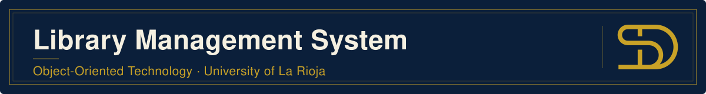
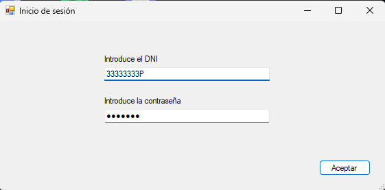
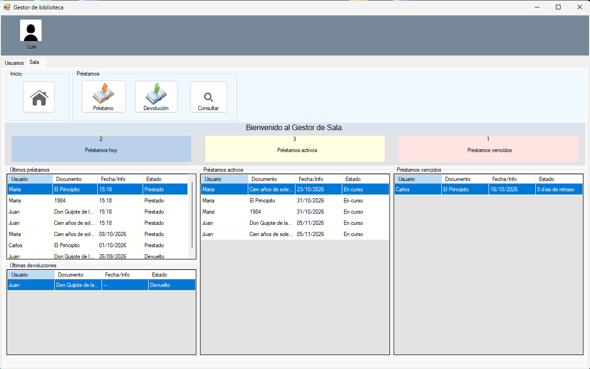
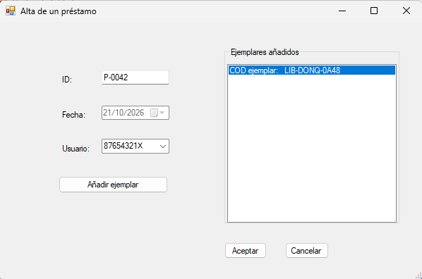
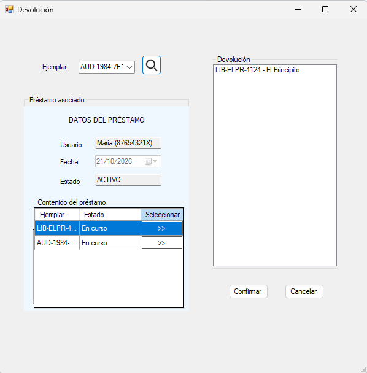
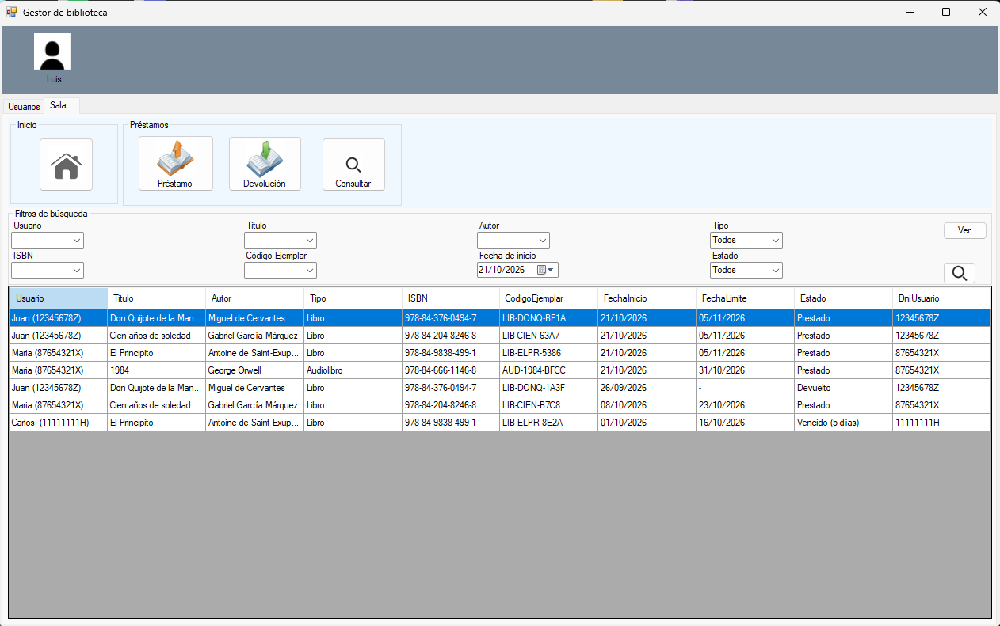
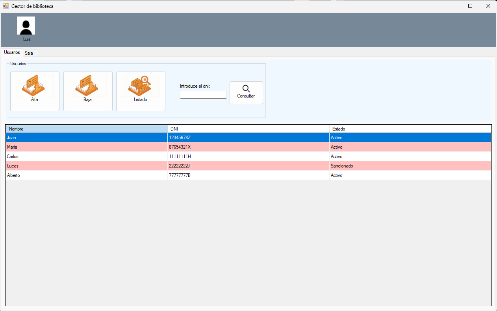
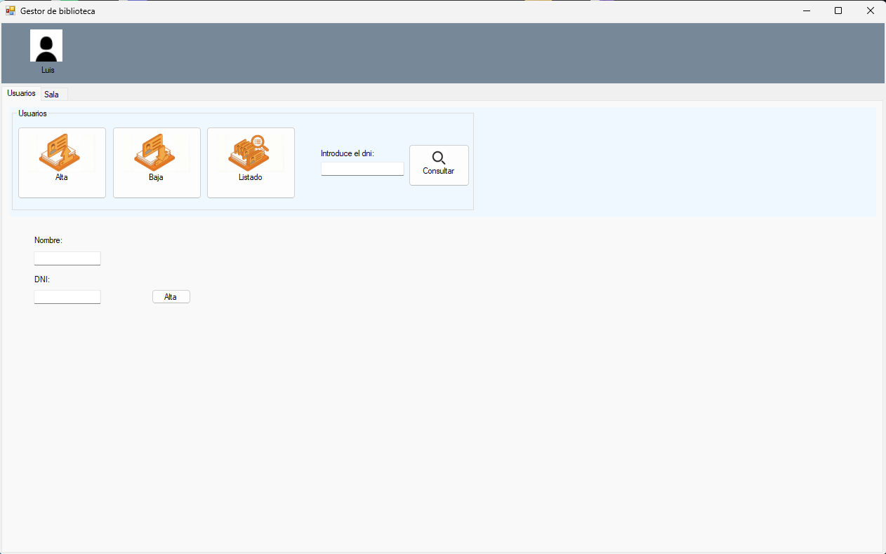
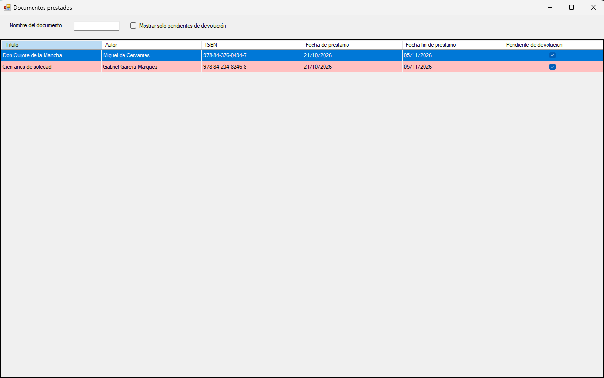
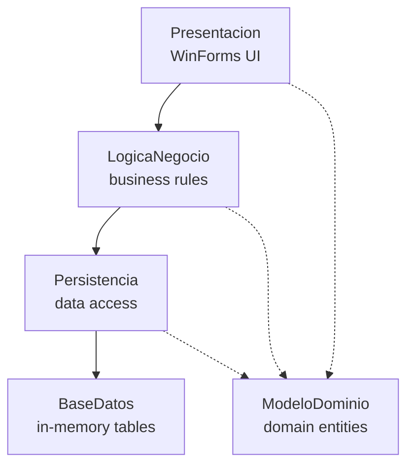

<p align="center"></p>

<p align="center">A layered C# WinForms desktop application for running a library: members, staff roles, documents and copies, loans and returns.</p>

<p align="center">
  
  
  <a href="https://github.com/santiagodie/library-management-system/releases/latest"></a>
</p>

## Table of Contents

- [About the Project](#about-the-project)
- [Screenshots](#screenshots)
- [Features](#features)
- [Built With](#built-with)
- [Architecture](#architecture)
- [Getting Started](#getting-started)
- [Test Accounts](#test-accounts)
- [Project Structure](#project-structure)
- [Known Limitations](#known-limitations)
- [Credits](#credits)
- [Contact](#contact)

## About the Project

A Windows desktop application for the day-to-day work of a library. Staff log in with their national ID (DNI) and password and get a different workspace depending on their role: circulation staff lend and take back copies, acquisitions staff manage the catalogue, and library members can check what they have borrowed.

The solution follows a layered architecture: the user interface, business rules, domain model, persistence and storage each live in their own .NET project (see [Architecture](#architecture)).

> This was a **group project by a team of three** (see [Credits](#credits)).

## Screenshots

| Login | Circulation dashboard |
|---|---|
|  |  |

| New loan | Return |
|---|---|
|  |  |

| Loan search | Members list |
|---|---|
|  |  |

| Add member | Member view |
|---|---|
|  |  |

## Features

- **Login by DNI and password**, with passwords stored as SHA-256 hashes. A person who is both staff and member chooses which role to use.
- **Members:** add, remove, look up by DNI and list members with their status (active or suspended).
- **Loans:** create a loan for one or more available copies. Books are due in 15 days and audiobooks in 10; suspended members cannot borrow.
- **Returns:** pick a copy, see the loan it belongs to and return some or all of its copies in one go.
- **Circulation dashboard:** loans made today, active loans and overdue loans (with days late), plus the latest loans and returns.
- **Loan search:** filter by member, title, author, ISBN, copy code, document type, start date and status.
- **Catalogue (acquisitions staff):** documents (books and audiobooks) and their copies, availability, the next date a document will be free and the most borrowed document of the month.
- **Member view:** a member's borrowed documents, filterable by title or by "pending return".

## Built With

- C# and .NET Framework 4.7.2
- Windows Forms
- Visual Studio 2022 / MSBuild
- GitHub Actions (Windows release build)

## Architecture

The solution has one project per layer:



| Layer | Project | Responsibility |
|---|---|---|
| Presentation | `Presentacion` | Forms and user controls, one workspace per role |
| Business logic | `LogicaNegocio` | `GestorUsuarios`, `GestorSala` and `GestorAdquisiciones`: validation and use cases |
| Domain model | `ModeloDominio` | Entities (`Usuario`, `Personal`, `Documento`, `Libro`, `Audiolibro`, `Ejemplar`, `Prestamo`) and password hashing |
| Persistence | `Persistencia` | Singleton repository that maps entities to data records (`*Dato`) and seeds the sample data |
| Database | `BaseDatos` | Generic in-memory tables that hold the records |

## Getting Started

### Download

Download the latest `LibraryManagementSystem-<version>.zip` from [Releases](https://github.com/santiagodie/library-management-system/releases/latest), unzip it and run `Presentacion.exe`. It needs Windows with .NET Framework 4.7.2 or later, which recent versions of Windows already include.

### Build from source

Prerequisites: Visual Studio 2022 (or Build Tools 2022) with the **.NET desktop development** workload and the .NET Framework 4.7.2 targeting pack.

```powershell
git clone https://github.com/santiagodie/library-management-system.git
cd library-management-system
msbuild GestiónBibliotecaGrupo09.sln /p:Configuration=Release
.\Presentacion\bin\Release\Presentacion.exe
```

You can also open the `.sln` in Visual Studio and press F5 (`Presentacion` is the startup project).

## Test Accounts

The application loads sample data on startup. All accounts are fictitious.

| Role | Name | DNI | Password |
|---|---|---|---|
| Circulation staff | Luis | `33333333P` | `sala123` |
| Circulation staff | Santiago | `44444444A` | `sala456` |
| Acquisitions staff | Ana | `55555555K` | `adq123` |
| Acquisitions staff | Javier | `66666666Q` | `adq456` |
| Acquisitions staff + member | Alberto | `77777777B` | `adq789` |
| Member | Juan | `12345678Z` | `juan321` |
| Member | Maria | `87654321X` | `maria123` |
| Member | Carlos | `11111111H` | `carl444` |
| Member (suspended) | Lucas | `22222222J` | `sancionado` |

## Project Structure

```
GestiónBibliotecaGrupo09.sln
├── Presentacion/        # WinForms UI: Login, FormPersonal, FormUsuario, loan and return dialogs, user controls
├── LogicaNegocio/       # GestorUsuarios, GestorSala, GestorAdquisiciones
├── ModeloDominio/       # Domain entities, enums and Hash (SHA-256)
├── Persistencia/        # Persistencia (repository), *Dato records, Transformer, PoblarBaseDatos (sample data)
└── BaseDatos/           # In-memory Tabla/Entidad storage
assets/                  # Banner and screenshots for this README
.github/workflows/       # Release build
```

## Known Limitations

- **No persistent storage.** Data lives in memory and is reset to the sample data every time the application starts.
- **Presentation also uses persistence directly.** `Presentacion` references `Persistencia` to seed the sample data at startup, so the layering is not strict at that point.
- **Windows only.** WinForms on .NET Framework.
- **Spanish interface.** The UI, code identifiers and comments are in Spanish.
- **No automated tests.**

## Credits

### Team

- [@angarcper](https://github.com/angarcper)
- [@javiersp21](https://github.com/javiersp21)
- [@santiagodie](https://github.com/santiagodie)

See also [CONTRIBUTORS.md](CONTRIBUTORS.md).

## Contact

Santiago Die · [GitHub](https://github.com/santiagodie) · [LinkedIn](https://www.linkedin.com/in/santiago-die-morejon)

---

Built for the Object-Oriented Technology course at the University of La Rioja (2025–26).
